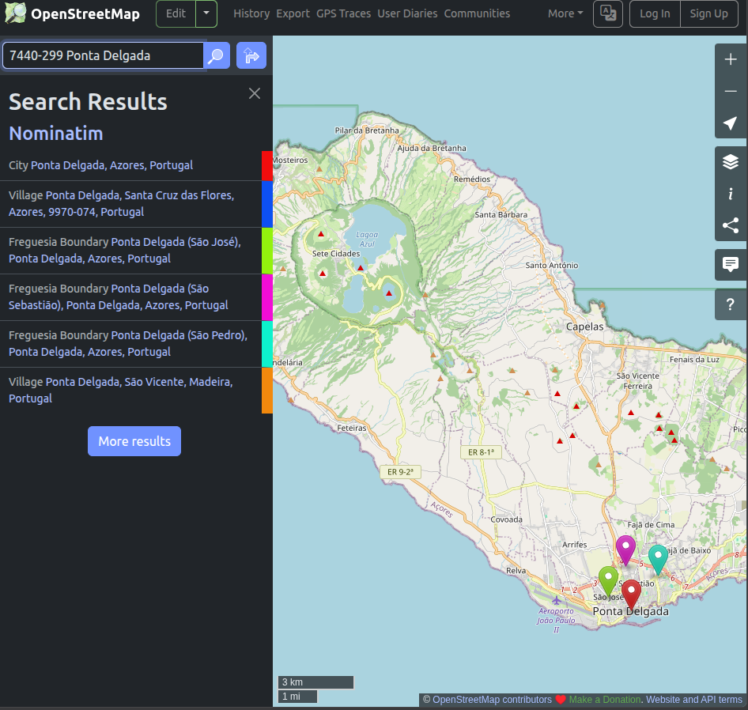
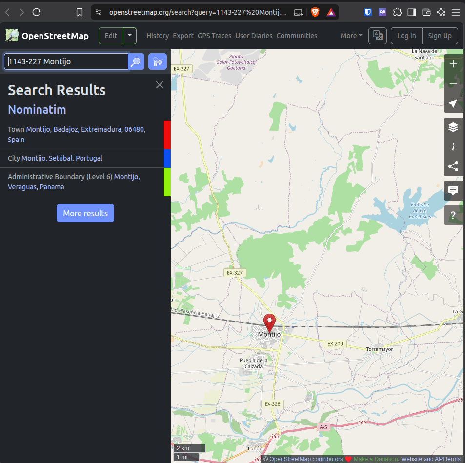

[](https://www.python.org/)
[](https://GitHub.com/brivadeneira/)


# geoapi_locust_testkit
Custom locust-based python test suite for dynamic API testing with geo-faker parameter generation.

# Geodata generator

## Features
- Generate realistic fake geolocation data **(latitude & longitude)**
  - Ensure locations are **on land** when required
- Generate fake full **addresses with city, state, and postal code**
  - Support for generating **real addresses** when needed

### 📍🏔️ Generate coordinates on land

`>_` [watch terminal recording](https://asciinema.org/a/1272850)
> *When viewing a recording just pause the player and copy-paste the content you want. It's just text after all!*

```python
>>> from services.geo_data_generator import FakeGeoGenerator
>>> from pprint import pprint
>>> fake_geo_generator = FakeGeoGenerator(seed=42)
>>>
>>> generated_coordinates_on_land = fake_geo_generator.generate_coordinates(on_land=True)
>>> pprint(generated_coordinates_on_land)
{'latitude': 59.89500309878519,
 'longitude': 166.07357393960402,
 'osm_url': 'https://www.openstreetmap.org/?mlat=59.89500309878519&mlon=-166.07357393960402&zoom=5'}
```

 [](https://www.openstreetmap.org/?mlat=59.89500309878519&mlon=-166.07357393960402&zoom=10)

### 📍🏞️ Generate coordinates inside a given bounding box (bbox)

`>_` [watch terminal recording](https://asciinema.org/a/1272853)

```python
>> > from services.geo_data_generator import FakeGeoGenerator
>> > from shapely.geometry import box
>> > from pprint import pprint
>> >
>> > fake_geo_generator = FakeGeoGenerator(seed=42)

# https://bboxfinder.com/#64.182129,53.733279,54.426270,50.047439
>> > bbox = box(minx=-64.182129, miny=-53.733279, maxx=-54.426270, maxy=-50.047439)
>> > generated_coordinates_inside_bbox = fake_geo_generator.generate_coordinates(bbox=bbox)
>> > pprint(generated_coordinates_inside_bbox)
{'latitude': -51.23907296127714,
 'longitude': -55.47815093479058,
 'osm_url': 'https://www.openstreetmap.org/?mlat=-51.23907296127714&mlon=-55.47815093479058&zoom=5'}
```

 [](https://www.openstreetmap.org/?mlat=-51.23907296127714&mlon=-55.47815093479058&zoom=5)


### 📍🏞️ Generate coordinates inside a given bounding box (bbox) and ensure they are on land

`>_` [watch terminal recording](https://asciinema.org/a/1272856)

```python
>> > from services.geo_data_generator import FakeGeoGenerator
>> > from shapely.geometry import box
>> > from pprint import pprint
>> > fake_geo_generator = FakeGeoGenerator(seed=42)

>> > bbox = box(minx=-64.182129, miny=-53.733279, maxx=-54.426270, maxy=-50.047439)
>> > generated_coordinates_inside_bbox = fake_geo_generator.generate_coordinates(bbox=bbox, on_land=True)
>> > pprint(generated_coordinates_inside_bbox)
{'latitude': -53.4128363731412,
 'longitude': -60.06591921812708,
 'osm_url': 'https://www.openstreetmap.org/?mlat=-53.4128363731412&mlon=-60.06591921812708&zoom=5'}

```

[](https://www.openstreetmap.org/?mlat=-51.57757752514003&mlon=-59.26370453286179&zoom=7)

### 📫 Generate a random address

`>_` [watch terminal recording](https://asciinema.org/a/1272857)

> Note: force locale to `pt_PT` for Portuguese addresses

```python
>> > from services.geo_data_generator import FakeGeoGenerator
>> >
>> > fake_geo_generator = FakeGeoGenerator()
>>> fake_geo_generator.generate_address(from_real_dataset=False)
{'address': 'Avenida de Nascimento, S/N, 7440-299 Ponta Delgada', 'osm_url': 'https://www.openstreetmap.org/search?query=7440-299%20Ponta%20Delgada'}

```
[](https://www.openstreetmap.org/search?query=7440-299%20Ponta%20Delgada)

```
>>>
>>> fake_geo_generator.generate_address(from_real_dataset=False)
{'address': 'Alameda Nascimento, S/N, 1143-227 Montijo', 'osm_url': 'https://www.openstreetmap.org/search?query=1143-227%20Montijo'}
```

[](https://www.openstreetmap.org/search?query=1143-227%20Montijo)


### Generate a random address with "real" address option enabled

`>_` [watch terminal recording](https://asciinema.org/a/1272858)

```python
>> > from services.geo_data_generator import FakeGeoGenerator

>> > fake_geo_generator = FakeGeoGenerator(seed=42)
>> > real_address = fake_geo_generator.generate_address(from_real_dataset=True)
>> > real_address
{'address': 'Koblen 2, SG, 9404, SWITZERLAND', 'osm_url': 'https://www.openstreetmap.org/search?query=Koblen%202%2C%20SG%2C%209404%2C%20SWITZERLAND'}
```

[](https://www.openstreetmap.org/search?query=Koblen%202%2C%20SG%2C%209404%2C%20SWITZERLAND)

## Installation and usage

* **python version**: 3.11

```shell
~$ curl -LsSf https://astral.sh/uv/install.sh | sh
~$ uv --version
uv 0.13.9 (x86_64-unknown-linux-gnu)
~$
~$ uv sync
```

### .env variables

```shell
~$ mv .env.example .env
~$ nano .env
```

```shell
```

## Testing

```shell
~$ poetry run pytest
======================================================================================================== test session starts =========================================================================================================
platform linux -- Python 3.11.11, pytest-9.0.2, pluggy-1.6.0
rootdir: /home/bibiana/geoapi_locust_testkit
configfile: pyproject.toml
plugins: asyncio-1.3.0, pretty-1.3.0, cov-7.0.0, Faker-40.8.0
asyncio: mode=Mode.STRICT, debug=False, asyncio_default_fixture_loop_scope=function, asyncio_default_test_loop_scope=function
collected 20 items

tests/services/test_fake_geo_generator.py ..............                                                                                                                                                                       [ 70%]
tests/test_dummy.py .                                                                                                                                                                                                          [ 75%]
tests/test_settings.py .....                                                                                                                                                                                                   [100%]

========================================================================================================== warnings summary ==========================================================================================================
tests/services/test_fake_geo_generator.py::TestFakeGeoGenerator::test_init_fake_geo_generator
  /home/bibiana/geoapi_locust_testkit/services/geo_data_generator.py:67: DeprecationWarning: The 'unary_union' attribute is deprecated, use the 'union_all()' method instead.
    union = gdf.unary_union

-- Docs: https://docs.pytest.org/en/stable/how-to/capture-warnings.html
Results (0.86s):
        20 passed
         1 warning
```

## Contribute
```shell
uv sync --group dev
uv run pytest

pre-commit clean
pre-commit install --install-hooks
```

## Doc


## License
This project is licensed under Apache Software License 2.0.
