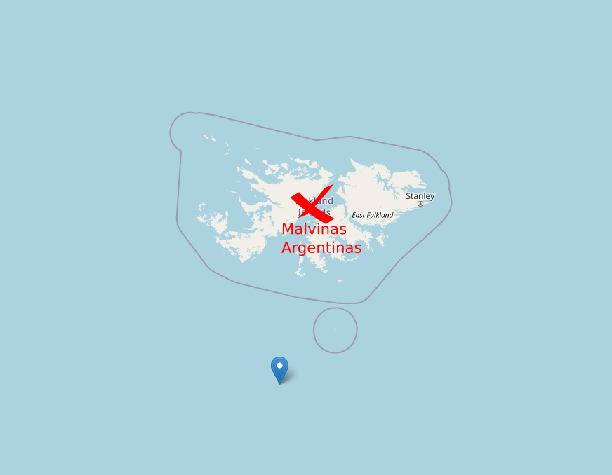
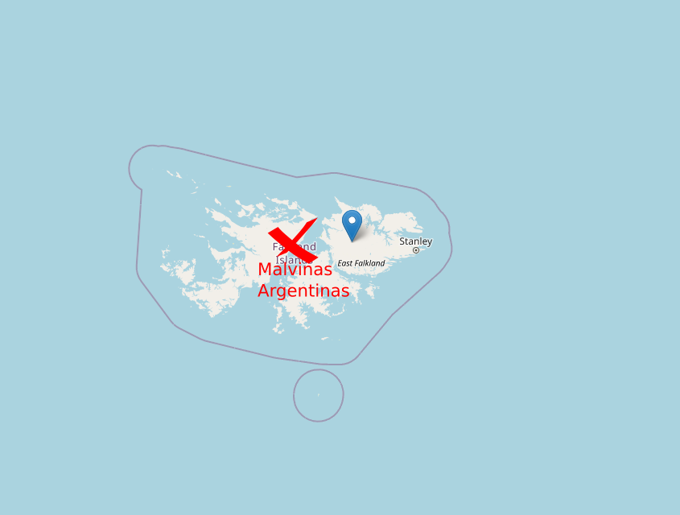

[](https://www.python.org/)
[](https://GitHub.com/brivadeneira/)


# geoapi_locust_testkit
Custom locust-based python test suite for dynamic API testing with geo-faker parameter generation.

# Geodata generator

## Features
- Generate realistic fake geolocation data **(latitude & longitude)**
  - Ensure locations are **on land** when required
- Generate fake full **addresses with city, state, and postal code**
  - Support for generating **real addresses** when needed

### 📍🏔️ Generate coordinates on land
```python
>>> from services.geo_data_generator import FakeGeoGenerator

>>> fake_geo_generator = FakeGeoGenerator(seed=42)

>>> lat, lon = fake_geo_generator.gen_coordinates(on_land=True)
>>> print(f"Generated coordinates: ({lat}, {lon}): https://www.openstreetmap.org/?mlat={lat}&mlon={lon}&zoom={10}")
# Generated coordinates:
# (59.89500309878519, -166.07357393960402):
# https://www.openstreetmap.org/?mlat=59.89500309878519&mlon=-166.07357393960402&zoom=10
```

 [](https://www.openstreetmap.org/?mlat=59.89500309878519&mlon=-166.07357393960402&zoom=10)

### 📍🏞️ Generate coordinates  on a specific bounding box (bbox)

```python
>>> from services.geo_data_generator import FakeGeoGenerator
>>> from shapely.geometry import box

>>> fake_geo_generator = FakeGeoGenerator(seed=42)

# https://bboxfinder.com/#64.182129,53.733279,54.426270,50.047439
>>> bbox = box(minx=-64.182129, miny=-53.733279, maxx=-54.426270, maxy=-50.047439)
>>> lat, lon = fake_geo_generator.gen_coordinates(bbox=bbox)
>>> print(f"Generated coordinates: ({lat}, {lon}): https://www.openstreetmap.org/?mlat={lat}&mlon={lon}&zoom={5}")
# Generated coordinates:
# (-51.23907296127714, -55.47815093479058)
# https://www.openstreetmap.org/?mlat=-51.23907296127714&mlon=-55.47815093479058&zoom=5
```

 [](https://www.openstreetmap.org/?mlat=-51.23907296127714&mlon=-55.47815093479058&zoom=5)


### generate coordinates on a specific bounding box (bbox) and ensure they are on land
```python
>>> from services.geo_data_generator import FakeGeoGenerator
>>> from shapely.geometry import box

>>> fake_geo_generator = FakeGeoGenerator(seed=42)

>>> bbox = box(minx=-64.182129, miny=-53.733279, maxx=-54.426270, maxy=-50.047439)
>>> lat, lon = fake_geo_generator.gen_coordinates(bbox=bbox, on_land=True)
>>> print(f"Generated coordinates: ({lat}, {lon}): https://www.openstreetmap.org/?mlat={lat}&mlon={lon}&zoom={7}")

# Generated coordinates:
# (-53.4128363731412, -60.06591921812708)
# Generated coordinates: (-53.4128363731412, -60.06591921812708): https://www.openstreetmap.org/?mlat=-53.4128363731412&mlon=-60.06591921812708&zoom=5
```

[](https://www.openstreetmap.org/?mlat=-51.57757752514003&mlon=-59.26370453286179&zoom=7)

### Generate a random address
```python
>>> from urllib.parse import quote
>>> from services.geo_data_generator import FakeGeoGenerator

>>> fake_geo_generator = FakeGeoGenerator(seed=42)
>>>
>>> print("\nGenerated fake addresses:")
>>> for _ in range(3):
...     print(fake_geo_generator.gen_address(real=False))
...     print()
...
# Diagonal 9 N° 71 Piso 1 Dto, 5 Salta 4400, Salta

# Diagonal Tierra del Fuego N° 835 Piso 4 Dto. 4, Constitución 1004, Ciudad Autónoma de Buenos Aires

# Avenida Río Gallegos N° 721,Santa Fe 3000, Santa Fe
```

### Generate a random address with real address option enabled
```python
>>> from services.geo_data_generator import FakeGeoGenerator

>>> fake_geo_generator = FakeGeoGenerator(seed=42)
>>> print("\nGenerated real addresses:")
>>> for _ in range(3):
...     print(f"real_address: {fake_geo_generator.gen_address(real=True)}")
...     print()


# WAILING RD 35, VG1110, BRITISH VIRGIN ISLANDS
# VIA A. NICOLODI 2, city_of_verona, 37124, ITA
# Waidhofnerstraße 1, Kautzen, 3851, AUT
```


### Generate a geo context
```python
>>> from services.geo_data_generator import FakeGeoGenerator

>>> fake_geo_generator = FakeGeoGenerator(seed=42)

>>> context = fake_geo_generator.gen_geo_context(on_land=True, real_address=True)
>>> print(context)
{'latitude': -10.166680095113664, 'longitude': 120.3067085689234, 'full_address': 'улица Зимовейская 28, 404378, RUS'}
```

## Installation and usage

* **python version**: 3.11

```shell
```

### .env variables

```shell
~$ mv .env.example .env
~$ nano .env
```

```shell
```

## Testing

```shell
```

## Contribute
```shell
uv sync --group dev
uv run pytest

pre-commit clean
pre-commit install --install-hooks
```

## Doc


## License
This project is licensed under Apache Software License 2.0.
