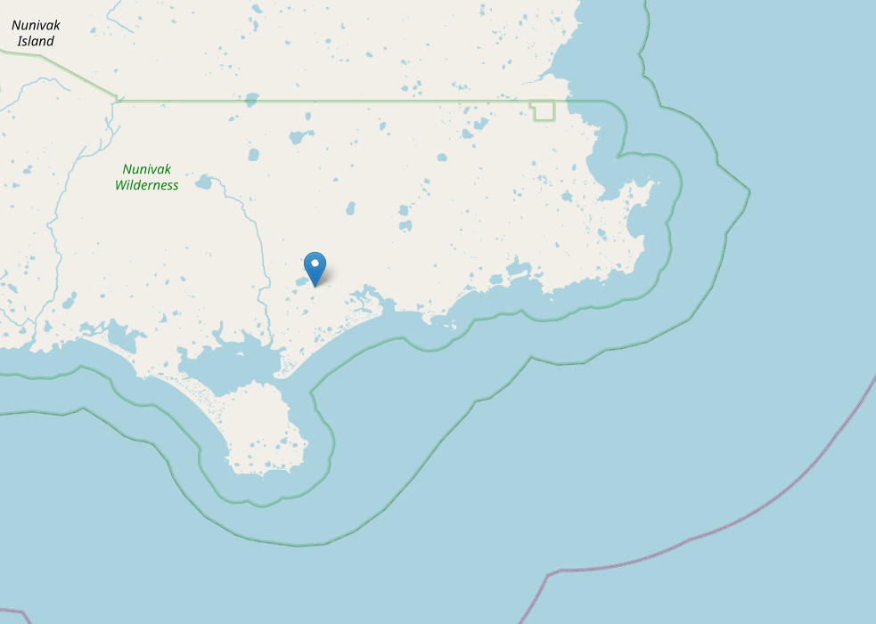
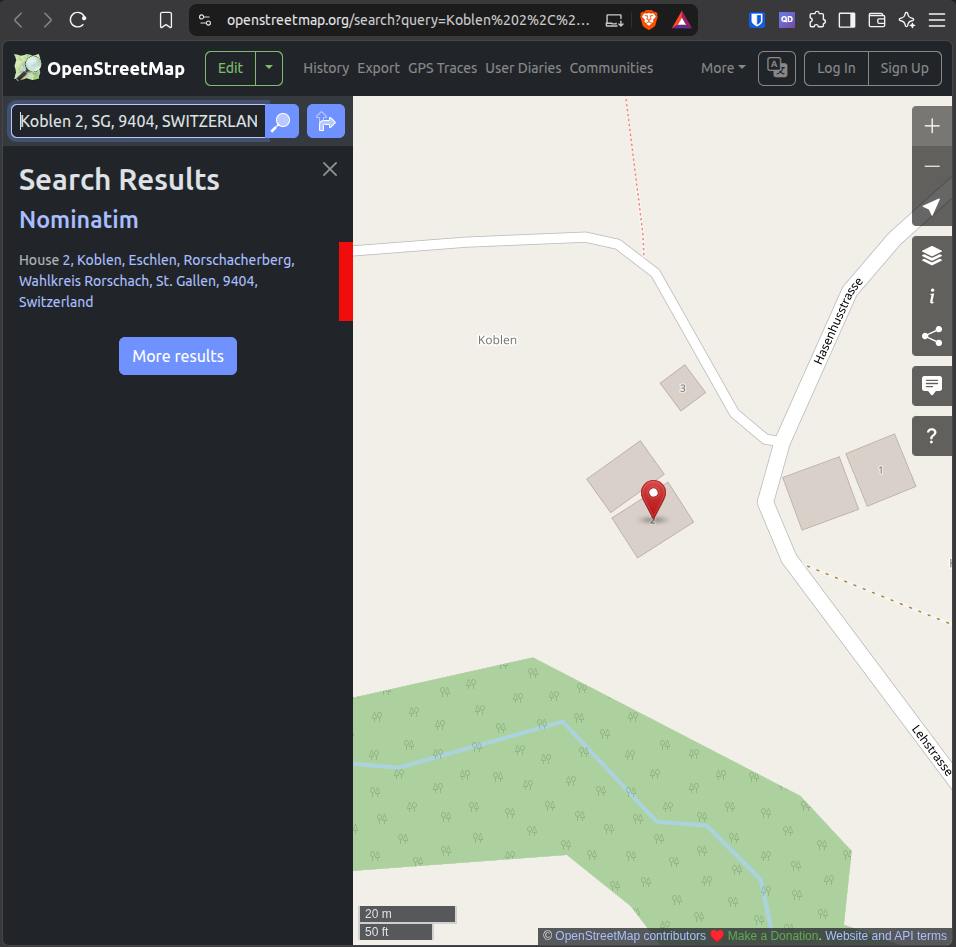

[](https://www.python.org/)
[](https://GitHub.com/brivadeneira/)


# geoapi_locust_testkit
A Python-based geographic **API testing toolkit built *on top of `Locust`*.

- It provides a reusable geographic data generator
- A configurable HTTP load-testing client via human-readable `YAML` & `Jinja2` for rendering.
- Enabling realistic location-based API testing through dynamically generated:
    - **coordinates and addresses,** using `faker` and `shapely` for bounding box management.

## Geodata generator

### Features
- Generate realistic fake geolocation data **(latitude & longitude)**
  - Ensure locations are **on land** when required
- Generate fake full **addresses with city, state, and postal code**
  - Support for generating **real addresses** when needed

#### 📍🏔️ Generate coordinates on land

`>_` [watch terminal recording](https://asciinema.org/a/1272874)
> *When viewing a recording just pause the player and copy-paste the content you want. It's just text after all!*

```python
>>> from services.geo_data_generator import init_fake_geo_generator
>>> from pprint import pprint
>>> fake_geo_generator = init_fake_geo_generator()
>>>
>>> generated_coordinates_on_land = fake_geo_generator.generate_coordinates(on_land=True)
>>> pprint(generated_coordinates_on_land)
{'latitude': 59.89500309878519,
 'longitude': 166.07357393960402,
 'osm_url': 'https://www.openstreetmap.org/?mlat=59.89500309878519&mlon=-166.07357393960402&zoom=5'}
```

 [](https://www.openstreetmap.org/?mlat=59.89500309878519&mlon=-166.07357393960402&zoom=10)

#### 📍🏞️ Generate coordinates inside a given bounding box (bbox)

```python
>> > from services.geo_data_generator import FakeGeoGenerator
>> > from shapely.geometry import box
>> > from pprint import pprint
>> >
>> > fake_geo_generator = FakeGeoGenerator(seed=42)

# https://bboxfinder.com/#64.182129,53.733279,54.426270,50.047439
>> > bbox = box(minx=-64.182129, miny=-53.733279, maxx=-54.426270, maxy=-50.047439)
>> > generated_coordinates_inside_bbox = fake_geo_generator.generate_coordinates(bbox=bbox)
>> > pprint(generated_coordinates_inside_bbox)
{'latitude': -51.23907296127714,
 'longitude': -55.47815093479058,
 'osm_url': 'https://www.openstreetmap.org/?mlat=-51.23907296127714&mlon=-55.47815093479058&zoom=5'}
```

 [](https://www.openstreetmap.org/?mlat=-51.23907296127714&mlon=-55.47815093479058&zoom=5)


#### 📍🏞️ Generate coordinates inside a given bounding box (bbox) and ensure they are on land

```python
>> > from services.geo_data_generator import FakeGeoGenerator
>> > from shapely.geometry import box
>> > from pprint import pprint
>> > fake_geo_generator = FakeGeoGenerator(seed=42)

>> > bbox = box(minx=-64.182129, miny=-53.733279, maxx=-54.426270, maxy=-50.047439)
>> > generated_coordinates_inside_bbox = fake_geo_generator.generate_coordinates(bbox=bbox, on_land=True)
>> > pprint(generated_coordinates_inside_bbox)
{'latitude': -53.4128363731412,
 'longitude': -60.06591921812708,
 'osm_url': 'https://www.openstreetmap.org/?mlat=-53.4128363731412&mlon=-60.06591921812708&zoom=5'}

```

[](https://www.openstreetmap.org/?mlat=-51.57757752514003&mlon=-59.26370453286179&zoom=7)

#### 📫 Generate a random address

> Note: force locale to `pt_PT` for Portuguese addresses

```python
>> > from services.geo_data_generator import FakeGeoGenerator
>> >
>> > fake_geo_generator = FakeGeoGenerator()
>> > fake_geo_generator.generate_address(real_address=False)
{'address': 'Avenida de Nascimento, S/N, 7440-299 Ponta Delgada',
 'osm_url': 'https://www.openstreetmap.org/search?query=7440-299%20Ponta%20Delgada'}

```
[](https://www.openstreetmap.org/search?query=7440-299%20Ponta%20Delgada)

```
>>>
>>> fake_geo_generator.generate_address(real_address=False)
{'address': 'Alameda Nascimento, S/N, 1143-227 Montijo', 'osm_url': 'https://www.openstreetmap.org/search?query=1143-227%20Montijo'}
```

[](https://www.openstreetmap.org/search?query=1143-227%20Montijo)


#### Generate a random address with "real" address option enabled

```python
>> > from services.geo_data_generator import FakeGeoGenerator

>> > fake_geo_generator = FakeGeoGenerator(seed=42)
>> > real_address = fake_geo_generator.generate_address(real_address=True)
>> > real_address
{'address': 'Koblen 2, SG, 9404, SWITZERLAND',
 'osm_url': 'https://www.openstreetmap.org/search?query=Koblen%202%2C%20SG%2C%209404%2C%20SWITZERLAND'}
```

[](https://www.openstreetmap.org/search?query=Koblen%202%2C%20SG%2C%209404%2C%20SWITZERLAND)


## API Testing Client
A configurable HTTP client driven by `YAML` API definitions.
- Uses `Jinja2` templates to dynamically generate request parameters
- and supports multiple endpoints, custom headers, and configurable execution settings.

## Load & Stress Testing
A Locust-powered testing toolkit for evaluating API performance under controlled workloads.
- Supports configurable concurrent `users`, `spawn rates`, `execution duration`, `wait times`, and endpoint selection, with structured logging and performance metrics.
- Designed to make geographic API testing reproducible, configurable, and easy to extend.

> It is being invoce via `CLI` and using a custom, but simple HTTP client.

### nominatim api test
####  coordinates gen in a given bbox and on_land
```yaml
 cat config/apis/nominatim.yaml
api:
  base_url: https://nominatim.openstreetmap.org

  endpoints:
    - name: search
      path: /search
      method: GET
      params:
        q: "{{ address }}"
        format: jsonv2
        limit: 1

    - name: reverse
      path: /reverse
      method: GET
      params:
        lat: "{{ latitude }}"
        lon: "{{ longitude }}"
        format: jsonv2

      bbox:
        xmin: -9.5
        ymin: 36.9
        xmax: -6.1
        ymax: 42.2
```

```bash
 geo_locust load-test \
    --api-name nominatim \
    --endpoint-paths reverse \
    --tags coordinates_inside_bbox_on_land


 [2026-11-18 16:30:57,337] bibiana/INFO/root: Generated fake coordinates | latitude=39.60048935648526 | longitude=-9.1909079986091 | osm_url=https://www.openstreetmap.org/?mlat=39.60048935648526&mlon=-9.1909079986091&zoom=5
[2026-11-18 16:30:57,337] bibiana/INFO/root: Rendered endpoint parameters | api=nominatim | endpoint=reverse | params={'lat': 39.60048935648526, 'lon': -9.1909079986091, 'format': 'jsonv2'}
[2026-11-18 16:30:57,337] bibiana/INFO/root: Calling endpoint | method=GET | path=/reverse | params={'lat': 39.60048935648526, 'lon': -9.1909079986091, 'format': 'jsonv2'}
[2026-11-18 16:30:57,449] bibiana/INFO/root: HTTP REQUEST | method=GET | url=https://nominatim.openstreetmap.org/reverse?lat=39.60048935648526&lon=-9.1909079986091&format=jsonv2
[2026-11-18 16:30:57,449] bibiana/INFO/root: HTTP RESPONSE | status_code=200 | response_time=0.111s | body={"place_id":284562769,"licence":"Data © OpenStreetMap contributors, ODbL 1.0. http://osm.org/copyright","osm_type":"relation","osm_id":295480,"lat":"39.6621648","lon":"-8.1353519","category":"boundary","type":"administrative","place_rank":4,"importance":0.8666415768245299,"addresstype":"country","name":"Portugal","display_name":"Portugal","address":{"country":"Portugal","country_code":"pt"},"boundingbox":["29.8282470","42.1543112","-31.5575303","-6.1891593"]}
[2026-11-18 16:30:58,953] bibiana/INFO/root: Generated fake coordinates | latitude=40.506550431530535 | longitude=-7.472209295511289 | osm_url=https://www.openstreetmap.org/?mlat=40.506550431530535&mlon=-7.472209295511289&zoom=5
[2026-11-18 16:30:58,953] bibiana/INFO/root: Rendered endpoint parameters | api=nominatim | endpoint=reverse | params={'lat': 40.506550431530535, 'lon': -7.472209295511289, 'format': 'jsonv2'}
[2026-11-18 16:30:58,953] bibiana/INFO/root: Calling endpoint | method=GET | path=/reverse | params={'lat': 40.506550431530535, 'lon': -7.472209295511289, 'format': 'jsonv2'}
[2026-11-18 16:30:59,080] bibiana/INFO/root: HTTP REQUEST | method=GET | url=https://nominatim.openstreetmap.org/reverse?lat=40.506550431530535&lon=-7.472209295511289&format=jsonv2
[2026-11-18 16:30:59,080] bibiana/INFO/root: HTTP RESPONSE | status_code=200 | response_time=0.126s | body={"place_id":293787905,"licence":"Data © OpenStreetMap contributors, ODbL 1.0. http://osm.org/copyright","osm_type":"way","osm_id":37200909,"lat":"40.5048325","lon":"-7.4729729","category":"highway","type":"track","place_rank":26,"importance":0.05338620813305864,"addresstype":"track","name":"Estradão Videmonte - Folgosinho","display_name":"Estradão Videmonte - Folgosinho, Porto de Melo, Folgosinho, Gouveia, Guarda, Portugal","address":{"road":"Estradão Videmonte - Folgosinho","hamlet":"Porto de Melo","village":"Folgosinho","city":"Gouveia","county":"Guarda","ISO3166-2-lvl6":"PT-09","country":"Portugal","country_code":"pt"},"boundingbox":["40.5037342","40.5259051","-7.4867388","-7.4043142"]}
```

`>_` [watch terminal recording](https://asciinema.org/a/1272876)

####  fake address, portugal biased via locale

```bash
geo_locust load-test \
    --api-name nominatim \
    --endpoint-paths search \
    --tags address

[2026-11-18 16:37:33,571] bibiana/INFO/root: Generated fake address | address=Av Magalhães, 451, 3872-624 Maia | osm_url=https://www.openstreetmap.org/search?query=3872-624%20Maia
[2026-11-18 16:37:33,571] bibiana/INFO/root: Rendered endpoint parameters | api=nominatim | endpoint=search | params={'q': 'Av Magalhães, 451, 3872-624 Maia', 'format': 'jsonv2', 'limit': 1}
[2026-11-18 16:37:33,571] bibiana/INFO/root: Calling endpoint | method=GET | path=/search | params={'q': 'Av Magalhães, 451, 3872-624 Maia', 'format': 'jsonv2', 'limit': 1}
[2026-11-18 16:37:34,274] bibiana/INFO/root: HTTP REQUEST | method=GET | url=https://nominatim.openstreetmap.org/search?q=Av+Magalh%C3%A3es%2C+451%2C+3872-624+Maia&format=jsonv2&limit=1
[2026-11-18 16:37:34,274] bibiana/INFO/root: HTTP RESPONSE | status_code=200 | response_time=0.703s | body=[]
Type     Name                                                                          # reqs      # fails |    Avg     Min     Max    Med |   req/s  failures/s
--------|----------------------------------------------------------------------------|-------|-------------|-------|-------|-------|-------|--------|-----------
GET      nominatim: search                                                                 13     0(0.00%) |    214      46     702     50 |    0.50        0.00
--------|----------------------------------------------------------------------------|-------|-------------|-------|-------|-------|-------|--------|-----------
         Aggregated                                                                        13     0(0.00%) |    214      46     702     50 |    0.50        0.00

[2026-11-18 16:37:35,775] bibiana/INFO/root: Generated fake address | address=Av Santos, 20, 2677-360 Póvoa de Varzim | osm_url=https://www.openstreetmap.org/search?query=2677-360%20P%C3%B3voa%20de%20Varzim
[2026-11-18 16:37:35,776] bibiana/INFO/root: Rendered endpoint parameters | api=nominatim | endpoint=search | params={'q': 'Av Santos, 20, 2677-360 Póvoa de Varzim', 'format': 'jsonv2', 'limit': 1}
[2026-11-18 16:37:35,776] bibiana/INFO/root: Calling endpoint | method=GET | path=/search | params={'q': 'Av Santos, 20, 2677-360 Póvoa de Varzim', 'format': 'jsonv2', 'limit': 1}
[2026-11-18 16:37:36,836] bibiana/INFO/root: HTTP REQUEST | method=GET | url=https://nominatim.openstreetmap.org/search?q=Av+Santos%2C+20%2C+2677-360+P%C3%B3voa+de+Varzim&format=jsonv2&limit=1
[2026-11-18 16:37:36,836] bibiana/INFO/root: HTTP RESPONSE | status_code=200 | response_time=1.059s | body=[{"place_id":286700275,"licence":"Data © OpenStreetMap contributors, ODbL 1.0. http://osm.org/copyright","osm_type":"way","osm_id":41843461,"lat":"41.3856070","lon":"-8.7683995","category":"highway","type":"tertiary","place_rank":26,"importance":0.053373877317463916,"addresstype":"tertiary","name":"Avenida Santos Graça","display_name":"Avenida Santos Graça, Nova Sintra, Póvoa de Varzim, Porto, 4490-433, Portugal","boundingbox":["41.3844733","41.3866324","-8.7713912","-8.7653430"]}]
Type     Name                                                                          # reqs      # fails |    Avg     Min     Max    Med |   req/s  failures/s
--------|----------------------------------------------------------------------------|-------|-------------|-------|-------|-------|-------|--------|-----------
GET      nominatim: search                                                                 14     0(0.00%) |    275      46    1059     50 |    0.50        0.00
--------|----------------------------------------------------------------------------|-------|-------------|-------|-------|-------|-------|--------|-----------
         Aggregated                                                                        14     0(0.00%) |    275      46    1059     50 |    0.50        0.00

[2026-11-18 16:37:38,337] bibiana/INFO/root: Generated fake address | address=Praça de Garcia, 88, 3430-980 Barcelos | osm_url=https://www.openstreetmap.org/search?query=3430-980%20Barcelos
[2026-11-18 16:37:38,337] bibiana/INFO/root: Rendered endpoint parameters | api=nominatim | endpoint=search | params={'q': 'Praça de Garcia, 88, 3430-980 Barcelos', 'format': 'jsonv2', 'limit': 1}
[2026-11-18 16:37:38,337] bibiana/INFO/root: Calling endpoint | method=GET | path=/search | params={'q': 'Praça de Garcia, 88, 3430-980 Barcelos', 'format': 'jsonv2', 'limit': 1}

```

`>_` [watch terminal recording](https://asciinema.org/a/1272877)


### Installation and usage

* **python version**: 3.11

```shell
~$ curl -LsSf https://astral.sh/uv/install.sh | sh
~$ uv --version
uv 0.13.9 (x86_64-unknown-linux-gnu)
~$
~$ uv sync
```

### .env variables

```shell
~$ mv .env.example .env
~$ nano .env
```

```shell
```

## Testing

```shell
~$ poetry run pytest
======================================================================================================== test session starts =========================================================================================================
platform linux -- Python 3.11.11, pytest-9.0.2, pluggy-1.6.0
rootdir: /home/bibiana/geoapi_locust_testkit
configfile: pyproject.toml
plugins: asyncio-1.3.0, pretty-1.3.0, cov-7.0.0, Faker-40.8.0
asyncio: mode=Mode.STRICT, debug=False, asyncio_default_fixture_loop_scope=function, asyncio_default_test_loop_scope=function
collected 20 items

tests/services/test_fake_geo_generator.py ..............                                                                                                                                                                       [ 70%]
tests/test_dummy.py .                                                                                                                                                                                                          [ 75%]
tests/test_settings.py .....                                                                                                                                                                                                   [100%]

========================================================================================================== warnings summary ==========================================================================================================
tests/services/test_fake_geo_generator.py::TestFakeGeoGenerator::test_init_fake_geo_generator
  /home/bibiana/geoapi_locust_testkit/services/geo_data_generator.py:67: DeprecationWarning: The 'unary_union' attribute is deprecated, use the 'union_all()' method instead.
    union = gdf.unary_union

-- Docs: https://docs.pytest.org/en/stable/how-to/capture-warnings.html
Results (0.86s):
        20 passed
         1 warning
```

## Contribute
```shell
uv sync --group dev
uv run pytest

pre-commit clean
pre-commit install --install-hooks
```

## Doc


## License
This project is licensed under Apache Software License 2.0.
